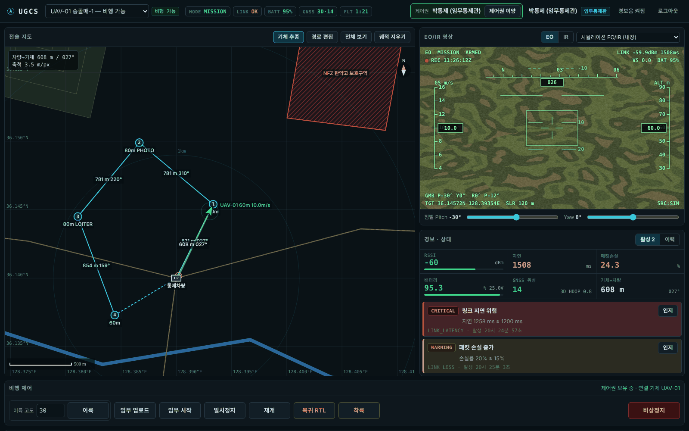
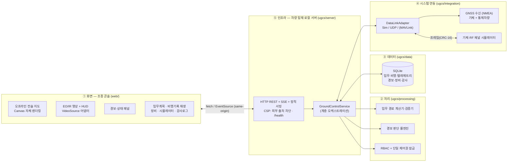

# Project 2 — 무인체계(무인기) 지상통제 시스템 (UGCS)

**UGCS (Unmanned Ground Control System)** 는 통제 차량 안의 온보드 서버에서 돌아가는 무인기 지상통제 시스템입니다.
**인터넷이 없는 폐쇄망(Air-gapped)** 을 전제로 만들었습니다. Python 표준 라이브러리와 브라우저 기본 기능만 사용하므로 별도 패키지 설치나 외부 CDN, 지도 타일 서버가 필요 없습니다.



| 항목 | 내용 |
| :--- | :--- |
| 서버 | Python 3.10+ 표준 라이브러리 (`http.server`, `sqlite3`, `threading`) — **외부 패키지 0개** |
| DB | SQLite 로컬 파일 (`data/ugcs.sqlite3`, WAL 모드) |
| 콘솔 | 순수 HTML/CSS/JS(ES Module) + Canvas 2D — 빌드 과정 없음 |
| 실시간 | Server-Sent Events(SSE) 5 Hz 상태 방송 |
| 기체 연동 | 데이터링크 어댑터 인터페이스 + 내장 기체/데이터링크 시뮬레이터 |
| 테스트 | `unittest` 81개 (처리·데이터·연동·서버 통합·폐쇄망 정책) |

---

## 1. 시스템 아키텍처 (5개 계층)



| 계층 | 위치 | 역할 |
| :--- | :--- | :--- |
| **① 화면** | [`web/`](web/) | 다크 톤 전술 콘솔. 지도·영상·경보 패널, 비행 명령, 운용 탭 |
| **② 처리** | [`ugcs/processing/`](ugcs/processing/) | `mission.py` 경로 계산·사전 검증 / `alerts.py` 경보 룰엔진 / `rbac.py` 역할·제어권 |
| **③ 데이터** | [`ugcs/data/`](ugcs/data/) | `schema.sql` 스키마, `db.py` 저장소(CRUD·상태 전이·영속화) |
| **④ 시스템 연동** | [`ugcs/integration/`](ugcs/integration/) | `datalink.py` 송수신 어댑터, `protocol.py` 프레임/CRC, `gnss.py` NMEA, `simulator.py` 기체 모델 |
| **⑤ 인프라** | [`ugcs/server/`](ugcs/server/), [`run.py`](run.py) | 로컬 HTTP/SSE 서버, 서비스 루프, 헬스체크, 기동 스크립트 |

### 1-1. ① 화면 — 조종 콘솔

- **전술 지도 (오프라인)**: 외부 타일 없이 Canvas로 직접 그립니다. 위경도 그리드, 1 km 거리 링, 통신 유효 반경, 지형(산·하천·저수지·도로), 금지구역(빗금), 지오펜스(점선), 통제차량(C2) 자차 위치, 기체 위치·기수 방향·비행 궤적, 웨이포인트 경로(구간 거리/방위 표시)를 보여줍니다.
  - 휠 줌, 드래그 팬, 키보드(화살표·`+`/`-`), **기체 추종(Follow)** 토글, 전체 보기
  - **경로 편집 모드**: 지도 클릭으로 WP 추가, 드래그로 이동, 우클릭으로 삭제. 편집할 때마다 서버에서 경로를 다시 계산하고 검증합니다.
  - 커서 좌표, 차량→커서 거리/방위, 차량→기체 거리/방위를 실시간으로 표시합니다.
- **EO/IR 영상 + HUD**: 텔레메트리와 지형 데이터로 그리는 모의 카메라 화면입니다. EO(주간 컬러)와 IR(백열 모드, 차량·건물 고온체 표시)을 전환할 수 있습니다.
  - HUD: 기수 테이프, 속도·고도 테이프, 피치 사다리(롤 반영), 짐벌 각도, 영상 중심 표적 좌표(TGT)·경사거리, 링크 RSSI/지연, 배터리, 녹화 시각
  - 링크가 끊기면 마지막 프레임에서 멈추고 노이즈와 경고를 띄웁니다.
  - `VideoSource` 인터페이스로 분리돼 있습니다. 같은 HUD 위에서 `SimulatedEoIrSource`(기본), `MjpegSource`(로컬 MJPEG), `WebRtcSource`(차량 내 RTSP→WHEP 게이트웨이용)로 바꿔 쓸 수 있습니다.
- **경보·상태 패널**: `CRITICAL`, `WARNING`, `INFO` 심각도별 목록을 보여줍니다. 미인지 CRITICAL은 깜빡이고 경보음이 납니다. 경보 인지(Acknowledge)와 발생·인지·해제 이력을 확인할 수 있습니다.
  - RSSI, 지연시간, 패킷손실률, 배터리(%/V), GNSS 위성 수와 Fix, 기체↔차량 거리, 현재 **제어권 보유자**를 항상 표시합니다.
- **비행 제어**: 이륙, 임무 업로드, 임무 시작, 일시정지, 재개, 복귀(RTL), 착륙, 비상정지. 위험 명령(RTL, 착륙, 비상정지)은 **2차 확인 창**을 거칩니다. 비상정지는 확인 문구를 직접 입력해야 실행됩니다.

### 1-2. ② 처리 — 핵심 제어·판단 엔진

**임무 경로 계산기** (`plan_mission`)

| 계산 항목 | 방법 |
| :--- | :--- |
| 구간 거리 | Haversine 대권거리 (+ 고도 변화 반영 3D 거리) |
| 방위각 | 초기 방위각(진북 기준) |
| 예상 시간 | `max(수평거리/속도, |고도변화|/수직속도) + 체공시간` |
| 배터리 소모 | 순항 0.045 %/s, 호버 0.055 %/s, 상승 0.015 %/m (`config.PERF`) |

사전 검증 항목은 금지구역 교차(구간 단위 선분-다각형 교차), 지오펜스 이탈(오목 다각형 포함), 최대·최저 고도, 통신 유효 반경 초과, 총 비행거리, 속도 범위, 배터리 예비량(착륙 시 20%) 미달입니다. `ERROR`가 하나라도 있으면 READY 승인과 업로드가 막힙니다.

**경보 판단 엔진** (`RuleEngine`): 5 Hz로 텔레메트리 스냅샷을 평가해 경보를 자동으로 발생(RAISE)시키고 해제(CLEAR)합니다.

| 코드 | 심각도 | 조건 |
| :--- | :--- | :--- |
| `LINK_LOST` | CRITICAL | Heartbeat 3초 이상 미수신 |
| `LINK_LATENCY` | WARNING → CRITICAL | 지연 ≥ 400 ms / ≥ 1200 ms (심각도 상승 시 재발생) |
| `LINK_LOSS` | WARNING | 패킷 손실률 ≥ 15 % (수신 순번 누락 기반 실측) |
| `BATTERY_LOW` / `BATTERY_CRITICAL` | WARNING / CRITICAL | ≤ 30 % / ≤ 15 % (2 % 히스테리시스) |
| `GEOFENCE_BREACH` · `NFZ_ENTRY` | CRITICAL | 허용구역 이탈 / 금지구역 진입 |
| `ROUTE_DEVIATION` | WARNING | 임무 중 현재 구간에서 60 m 이상 이탈 |
| `COMM_RANGE` | WARNING / CRITICAL | 통신 반경 90 % 이상 / 초과 |
| `GPS_DEGRADED` | WARNING | 3D Fix 없음 또는 위성 6개 미만 |
| `GROUNDED_TAKEOFF` | CRITICAL | 정비 불가 기체(`GROUNDED`, `MAINTENANCE_REQUIRED`)의 이륙·임무 시작 시도. 이벤트형이며 인지하면 해제됩니다. |

링크가 끊긴 동안에는 텔레메트리가 낡은 값이므로 위치·배터리 경보를 **동결(유지)** 합니다. 해제된 것으로 잘못 판단하지 않기 위해서입니다.

**조작 권한 (RBAC + 단일 제어권)**

| 권한 | PILOT 조종사 | MISSION_CTRL 임무통제관 | MAINTENANCE 정비사 | OBSERVER 관찰자 |
| :--- | :---: | :---: | :---: | :---: |
| 상태·임무·기록 조회 | ✓ | ✓ | ✓ | ✓ |
| 제어권 인수 / 비행 명령 | ✓ | ✓ | — | — |
| 제어권 **강제 인수** | — | ✓ | — | — |
| 임무 작성·수정 | ✓ | ✓ | — | — |
| 임무 READY 승인 · 보관 | — | ✓ | — | — |
| 정비 기록·기체 상태 변경 | — | — | ✓ | — |
| 시뮬레이터 장애 주입 | — | ✓ | ✓ | — |
| 경보 인지 | ✓ | ✓ | ✓ | — |
| 감사 로그 열람 | — | ✓ | — | — |

- 비행 제어 명령(이륙, 웨이포인트·임무 업로드, 임무 시작·중단, RTL, 착륙, 비상정지, 짐벌)은 **역할 권한과 현재 제어권 보유**를 모두 충족해야 실행됩니다.
- 둘 중 하나라도 충족하지 못하면 서버 API 단계에서 **`403 Forbidden`** 으로 차단하고 감사 로그에 `DENIED`로 기록합니다. 화면에서 버튼을 비활성화하는 것은 보조 수단입니다.
- 위험 명령은 UI 확인과 별도로, 서버도 `confirm` 토큰이 없으면 `428`로 거부합니다.
- 제어권은 한 명만 가질 수 있습니다. 다른 사람이 보유 중일 때 인수를 요청하면 `409`가 반환됩니다. 강제 인수는 임무통제관만 할 수 있고 감사 로그에 `CONTROL_FORCE`로 기록됩니다. 제어권 상태는 DB에 저장되므로 서버를 재기동해도 유지됩니다.

### 1-3. ③ 데이터 — 로컬 DB 영속 계층

스키마 정의는 [`ugcs/data/schema.sql`](ugcs/data/schema.sql)에 있습니다.

| 테이블 | 내용 |
| :--- | :--- |
| `missions` | 임무명, 대상 기체, 웨이포인트 JSON(위도·경도·고도·속도·체공시간·임무동작), 지오펜스, 버전, 상태(`DRAFT`→`READY`→`UPLOADED`→`ARCHIVED`), 마지막 검증 결과 |
| `flights` / `telemetry` | 비행 세션(시작·종료 시각, 운용자, 사용 임무, 거리, 최고고도, 종료 사유) + 1 Hz 텔레메트리 스냅샷 → **경로 재생** |
| `alerts` | 경보 발생·인지(인지자)·해제 시각, 원인, 비행 세션 연결 |
| `maintenance` / `aircraft` | 점검 일자, 작업자, 유형(정기점검·수리·부품교체), 체크리스트, 결과 가용 상태. **정비 기록을 저장하면 기체 상태가 즉시 바뀌고**, 이 상태가 이륙 차단에 연동됩니다. |
| `audit` | 로그인, 제어권 인수·이양·강제 인수, 모든 명령과 쓰기 요청의 허용·거부·오류. 삭제 API는 없습니다. |
| `users` / `sessions` / `control_lock` | PBKDF2 해시 PIN, 세션 토큰, 단일 제어권 |

- 임무를 수정하면 **버전이 오르고 DRAFT로 돌아갑니다**. 다시 검증하고 승인받아야 합니다. `UPLOADED` 상태는 업로드 명령의 ACK를 받았을 때만 설정됩니다.
- 전원이 갑자기 끊겼다가 다시 들어오면, 종료되지 않은 비행 세션은 "서버 재기동으로 세션 종료"로 마감하고 조건형 경보를 정리합니다. 이후 룰엔진이 상태를 다시 판단합니다.

### 1-4. ④ 시스템 연동 — 데이터링크 & 위치정보

```text
GCS(서버)                                   가상 RF 채널                         기체
DataLinkAdapter ── COMMAND(cmd_id) ──▶ [지연·지터·손실·비트오류·단절] ──▶ handle_command
              ◀─ COMMAND_ACK(cmd_id) ──                                  ◀── ACCEPTED/DENIED
              ── MISSION_COUNT, MISSION_ITEM×N ─▶          ...            ──▶ load_mission
              ◀──────── MISSION_ACK ──────────                           (누락 시 INCOMPLETE → 재전송)
              ◀── TELEMETRY 5Hz (NMEA GGA/RMC 포함), HEARTBEAT 1Hz ──
              ── GCS_HEARTBEAT 1Hz ──▶  (10초 끊기면 기체 페일세이프 RTL)
```

- **프레임**: `STX | LEN | SEQ | SYSID | MSGID | PAYLOAD | CRC-16/X.25` 형식으로 MAVLink v2 구조를 단순화했습니다. `StreamParser`가 깨진 바이트를 버리고 다음 프레임에서 다시 동기화합니다.
- **ACK·재전송**: 명령마다 `cmd_id`를 붙이고 타임아웃 후 재전송합니다(기본 3회). 끝내 응답이 없으면 `LinkTimeout`이 발생하고 API는 `504`를 반환합니다.
- **링크 품질 실측**: 지연은 송신 시각 스탬프로, 손실률은 수신 순번 누락으로, RSSI는 거리 기반 경로손실 모델로 계산합니다. 통신 반경 90 %를 넘으면 손실률이 올라갑니다.
- **어댑터 교체**: `SimulatedDataLink`가 기본입니다. `UdpDataLink`는 같은 프레임을 UDP로 주고받습니다. 실제 MAVLink 장비를 쓰려면 같은 인터페이스를 구현한 클래스를 하나 추가하면 됩니다.
- **GNSS**:
  - 기체 위치는 텔레메트리에 실린 NMEA 문장(GGA·RMC)을 체크섬 검증 후 파싱해 얻습니다. 위도, 경도, 고도, 헤딩, 속도, Fix, 위성 수가 포함됩니다.
  - 통제 차량 자차 위치는 `GnssSource` 인터페이스로 받습니다. 기본값은 `SimulatedVehicleGnss`이고, 실제 수신기는 `SerialNmeaGnss`(pyserial을 반입한 경우)로 연결합니다.
  - 기체↔차량 직선거리, 방위각, 통신 반경 이내 여부를 실시간으로 계산합니다.
- **시뮬레이터**: 멀티콥터 운동 모델로 선회율, 상승률, 가감속을 반영합니다. 모드별 배터리 소모와 전압 곡선, 바람 편류, GNSS 저하도 모사합니다. 페일세이프는 링크 단절 시 RTL, 배터리 10 % 이하에서 착륙, 비상정지 시 자유낙하로 동작합니다.

### 1-5. ⑤ 인프라 — 폐쇄망 · 차량 탑재 서버 원칙

1. **외부 네트워크를 쓰지 않습니다.** CDN, Google Fonts, 온라인 지도 타일, 외부 API 호출이 하나도 없습니다. 폰트는 OS 기본 서체를 쓰고, 아이콘은 로컬 SVG, 지도는 Canvas로 그립니다.
   - 모든 응답에 `Content-Security-Policy: default-src 'self'; connect-src 'self' …` 헤더를 붙입니다. 실수로 외부 URL이 들어가도 브라우저가 로드를 막습니다.
   - 테스트 `AirGapPolicyTest`가 웹 리소스의 외부 URL과 서버 코드의 서드파티 import를 정적으로 검사합니다.
2. **의존성이 없습니다.** Python 표준 라이브러리만 사용하므로 `pip install`이 필요 없습니다. 차량 PC에 Python 3.10 이상만 있으면 됩니다.
3. **영속화**: SQLite WAL 모드에 `synchronous=NORMAL`을 씁니다. 커밋된 임무 계획, 비행 기록, 정비 이력, 감사 로그, 제어권, 세션은 전원을 재투입한 뒤에도 남아 있습니다.
4. **차량 LAN 서비스**: 기본 바인딩은 `0.0.0.0:8080`입니다. 같은 LAN의 다른 콘솔(태블릿 등)도 브라우저로 접속할 수 있습니다.
5. **헬스체크**: `GET /health`는 인증 없이 DB 무결성(`quick_check`), 데이터링크 연결, 서비스 루프 상태를 반환합니다. 정상이면 200, 이상이면 503입니다.

---

## 2. 폴더 구조

```text
project-2/
├── README.md                 # 이 문서
├── run.py                    # 서버 기동 (python run.py)
├── run.bat / run.sh          # Windows / Linux 원클릭 실행
├── ugcs/                     # 서버 패키지 (표준 라이브러리 전용)
│   ├── config.py             # 포트·DB 경로·성능·검증 한계·경보 임계치 (UGCS_* 환경변수로 변경)
│   ├── geo.py                # Haversine, 방위, 국지 투영, 다각형/선분 기하
│   ├── processing/           # ② 처리: mission.py · alerts.py · rbac.py
│   ├── data/                 # ③ 데이터: schema.sql · db.py
│   ├── integration/          # ④ 연동: datalink.py · protocol.py · gnss.py · simulator.py
│   └── server/               # ⑤ 인프라: app.py(HTTP/SSE/정적/CSP) · service.py(오케스트레이터)
├── web/                      # ① 화면: 조종 콘솔 정적 리소스 (빌드 없음)
│   ├── index.html
│   ├── css/console.css
│   ├── js/  app.js · map.js · video.js · ops.js · api.js · geo.js
│   └── assets/favicon.svg
├── tests/                    # unittest 자동화 테스트 (81개)
├── docs/
│   ├── api.md                # REST/SSE API 명세
│   └── screenshot.png
└── data/                     # 런타임 SQLite 파일 위치 (git 제외)
```

## 3. 로컬 설치 · 실행

준비물은 **Python 3.10 이상** 하나뿐입니다. Windows에서 Anaconda Python을 써도 됩니다. 추가로 설치할 패키지는 없습니다.

```bash
cd project-2
python run.py                 # http://127.0.0.1:8080/  (차량 LAN: http://<서버IP>:8080/)
python run.py --port 9000     # 포트 변경
python run.py --reset         # DB를 지우고 시드 데이터로 새로 시작
```

Windows에서는 `run.bat`을 더블클릭해도 됩니다. 브라우저로 콘솔에 접속한 뒤 아래 계정으로 로그인하세요.

| 계정 | PIN | 역할 |
| :--- | :--- | :--- |
| `pilot1`, `pilot2` | `1111`, `1112` | PILOT 조종사 |
| `mc1` | `2222` | MISSION_CTRL 임무통제관 |
| `maint1` | `3333` | MAINTENANCE 정비사 |
| `obs1` | `4444` | OBSERVER 관찰자 |

> 기본 PIN은 훈련·개발용입니다. 실제로 운용하기 전에 `users` 테이블의 계정을 바꾸세요.

헬스체크:

```bash
curl http://127.0.0.1:8080/health
# {"status":"ok","version":"1.0.0","db":{"ok":true,...},"datalink":{"adapter":"sim-datalink","connected":true,...},"network":"local-only"}
```

테스트 실행:

```bash
cd project-2
python -m unittest discover -s tests -v
```

## 4. 시뮬레이터 테스트 시나리오

| # | 시나리오 | 절차 | 기대 결과 |
| :--- | :--- | :--- | :--- |
| 1 | **정상 임무** | `pilot1` 임무 작성 → `mc1` READY 승인 → `pilot1` 제어권 인수 → 임무 업로드 → 임무 시작 | 자동 이륙 후 WP를 순서대로 비행하고 RTL로 착륙. 비행 기록 탭에서 경로 재생 가능 |
| 2 | **경로 검증** | 지도 편집 모드에서 WP를 금지구역 안에 찍거나 150 m 넘게 설정 | 오류 목록에 `NFZ_CROSS`, `MAX_ALT` 표시. READY 승인과 업로드가 `409 PLAN_INVALID`로 거부됨 |
| 3 | **권한 차단** | `obs1`로 `POST /api/commands/TAKEOFF`, 또는 제어권 없는 `pilot2`로 RTL 요청 | `403 ROLE_DENIED` / `403 NO_CONTROL`. 감사 로그 탭(`mc1`)에 `DENIED`로 기록 |
| 4 | **제어권 이양/강제 인수** | `pilot1` 보유 중 `pilot2` 인수 요청 → `mc1` 강제 인수 | `409 LOCK_HELD` → 강제 인수 성공. 이후 `pilot1` 명령은 403 |
| 5 | **데이터링크 단절** | 시뮬레이터 탭 → "링크 단절 15초 후 자동 복구" | 3초 후 `LINK_LOST`(CRITICAL)와 영상 정지. 10초 후 기체가 페일세이프 RTL. 복구되면 경보가 자동 해제되고 이력에 남음 |
| 6 | **지연·손실** | "지연 1500 ms + 손실 25%" | `LINK_LATENCY` CRITICAL, `LINK_LOSS` WARNING. 명령은 재전송 후 ACK |
| 7 | **배터리 급감** | 비행 중 "배터리 급감" 또는 소모 배율 ×10 | `BATTERY_LOW` → `BATTERY_CRITICAL`. 10 % 이하가 되면 기체가 자동 착륙 |
| 8 | **정비 불가 기체** | 상단에서 `UAV-02`(GROUNDED) 선택 → 이륙 | `409 AIRCRAFT_NOT_AIRWORTHY`와 `GROUNDED_TAKEOFF` CRITICAL 경보. `maint1`이 정비 기록을 `AIRWORTHY`로 저장하면 이륙 가능 |
| 9 | **경로 이탈** | 임무 중 측풍 슬라이더를 5 m/s 이상으로 설정 | 직접 조준 비행이 편류로 밀려 계획 구간에서 60 m 넘게 벗어나면 `ROUTE_DEVIATION` WARNING |
| 10 | **전원 재투입** | 서버 Ctrl+C → 다시 `python run.py` | 임무, 비행 기록, 정비 이력, 감사 로그, 제어권 보유자 유지 |

시나리오 1, 3, 4, 5, 8, 10과 경로 검증은 `tests/test_api.py`에서 실제 서버를 띄워 자동으로 검증합니다.

## 5. 실장비 연동 시 교체 지점

| 대상 | 교체 방법 |
| :--- | :--- |
| 데이터링크 | `DataLinkAdapter`를 상속한 `MavlinkDataLink`(시리얼/UDP)를 구현하고 `GroundControlService(link=...)`에 주입 |
| 차량 GNSS | `SerialNmeaGnss(port="COM3")`를 `GroundControlService(gcs_gnss=...)`에 주입 (pyserial wheel 반입 필요) |
| 영상 | 차량 내 미디어 게이트웨이(RTSP→WHEP/MJPEG)를 같은 서버 경로(`/video/...`)로 프록시하고, 콘솔 영상 소스를 `MjpegSource`/`WebRtcSource`로 선택 |
| 공역 데이터 | `zones` 테이블(NFZ·GEOFENCE·TERRAIN)에 작전 지역 폴리곤 입력 |

API 상세는 [docs/api.md](docs/api.md)에 있습니다.
